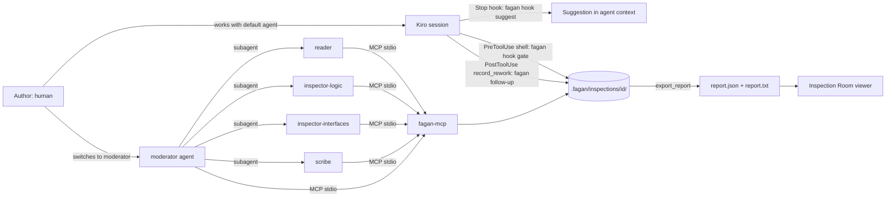
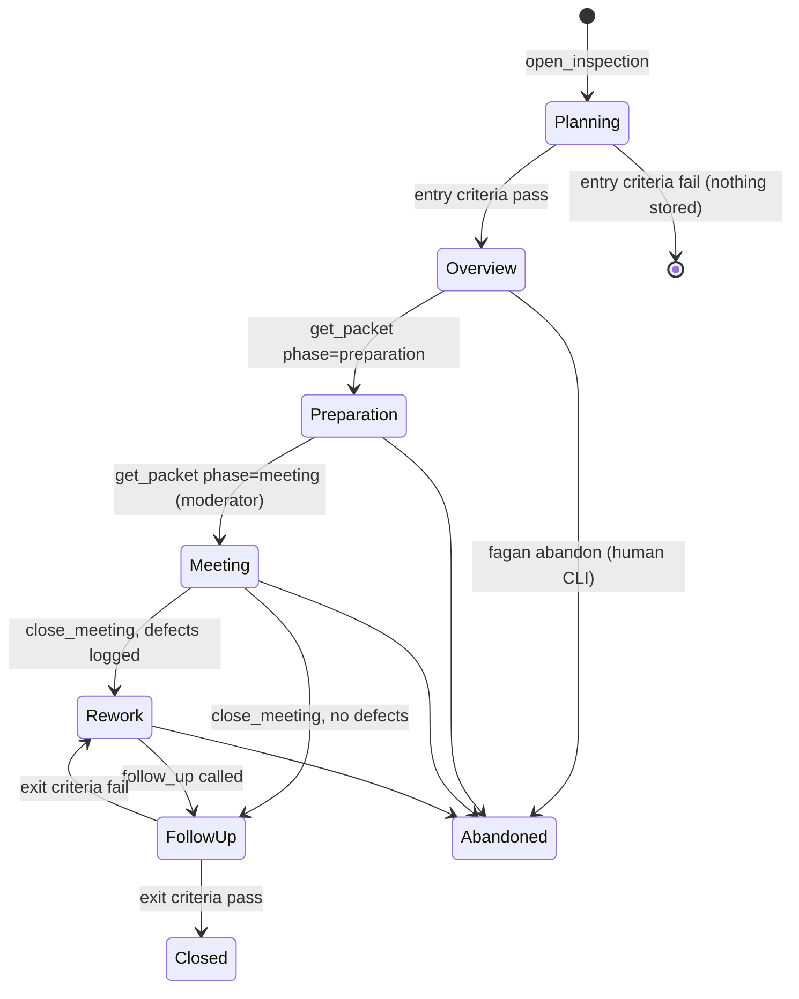

# Fagan's Ghost: Plan

Kiroween 2026, category Resurrection. This file is the plan for step 1 of the work order. It contains no code.

## 0. Status and approval gate

- Status: **approved; core, role configuration, viewer and local power implemented; local verification passed; Author-approved waiver and passing follow-up recorded; local implementation and validation complete; Kiro IDE and public-action handoffs remain.**
- The plan was approved with the decisions listed under section 23. Step 2 is committed and verified. Step 3 has five role agents, hooks and recorded live experiments. The real Codex-role inspection is recorded as insp-0001, Closed after a human-approved false-positive waiver for D001 and passing build/test follow-up. The Inspection Room and power installer are implemented. See docs/verification.md for final checks and outstanding Kiro IDE work. The 2026-11-17 continuation uses Codex through T3 Code for implementation and keeps Kiro runtime verification separate (docs/experiments.md).
- Open questions that still need your answer are in section 23.

## 1. Goal and framing

Fagan's Ghost brings back Michael Fagan's 1976 formal code inspection as a ritual run inside Kiro. The point is the ceremony: fixed roles, fixed phases, entry and exit criteria, and a defect log with measured rates. It is not a generic "AI code reviewer". The roles are played by Kiro custom agents, Kiro hooks start and enforce the ceremony, and a deterministic MCP server (`fagan-mcp`) keeps the record. The human is always the Author and has the final word: only the Author can waive a major defect, and only with a written reason.

- **Problem.** AI agents now write large diffs that nobody reads closely before committing.
- **Audience.** Developers shipping AI-written code, students, and small teams with no second reviewer.
- **Reach.** A Kiro power installs the whole ritual (MCP server, role agents, hooks, steering, checklists) into any git repo.
- **Theme fit (Resurrection).** A dead 1970s process rebuilt with agents as the participants. The Inspection Room viewer replays a real inspection as a séance: the roles sit around a table, the Reader's paraphrase is spelled out like a planchette, defects appear as ghosts pinned to code lines, and follow-up exorcises the fixed ones. No jump scares, no blood, no copyrighted horror assets.
- **Honesty rule.** `fagan-mcp` and the viewer make no model calls. Every inspection, defect and metric shown anywhere comes from actually running the tool. Metrics come from server-side timestamps of tool calls that move the inspection between phases. Nothing watches a human or measures eyes-on time (this keeps it clear of the separate "Read Receipt" entry; no code is shared with it).

## 2. Kiro surface and feature support matrix

### 2.1 Which surface this work runs on

At planning time, the agent doing the work was the **Kiro CLI V3 harness** (`kiro-cli` 3.2.1) driven over ACP by T3 Code. Per the [ACP docs](https://kiro.dev/docs/cli/acp.md), `kiro-cli acp` starts the V3 harness by default on macOS unless V2-only flags such as `--agent` are passed. The Kiro IDE is not on this machine's PATH, so IDE-only steps are listed for you in section 2.3.

Installed `kiro-cli` subcommands observed on this run: `agent {list, create, edit, validate, migrate, upgrade, set-default}`, `chat`, `mcp {add, remove, list, import, status}`, `powers {install, uninstall}`, `settings`, `crew`, `serve`, `acp`.

### 2.2 Feature matrix

"CLI V3" means Kiro CLI V3 as driven by T3 Code over ACP. Support values are copied from the kiro.dev availability tables. Where ACP behaviour is not stated in the docs, the row points to an experiment in section 2.4.

| Feature | CLI V3 (T3 Code / ACP) | IDE | How Fagan's Ghost uses it | Docs |
| --- | --- | --- | --- | --- |
| Hooks: event-driven, command actions, agent prompt actions | Yes | Yes | Three workspace hooks in `.kiro/hooks/` (section 11) | [Hooks](https://kiro.dev/docs/hooks/), [Actions](https://kiro.dev/docs/hooks/actions/) |
| Trigger: Agent Stop (`Stop`) | Yes | Yes | "Suggest an inspection" hook | [Hook types](https://kiro.dev/docs/hooks/types/) |
| Trigger: Pre Tool Use (`PreToolUse`) | Yes | Yes | Commit gate, exit code 2 blocks | [Hook types](https://kiro.dev/docs/hooks/types/), [IDE 1.0 hooks](https://kiro.dev/docs/ide/whats-new-v1/hooks.md) |
| Trigger: Post Tool Use (`PostToolUse`) | Yes | Yes | After `record_rework`, run tests and follow-up | [Hook types](https://kiro.dev/docs/hooks/types/) |
| Trigger: Pre/Post Task Execution (`PreTaskExec`, `PostTaskExec`) | Yes (V3) | Yes | Considered for the suggest hook, not chosen (section 11.1) | [Hook types](https://kiro.dev/docs/hooks/types/) |
| Trigger: Session Start / Session End / Compaction / File events | Session Start yes (V3), Session End V3 only, Compaction V3 3.1.0+, File events V3 | Session Start yes, Session End no, Compaction yes, File events yes | Not used; no workflow needs them. Explained in KIRO_USAGE.md | [Hook types](https://kiro.dev/docs/hooks/types/), [CLI V3 hooks migration](https://kiro.dev/docs/cli/v3/hooks-migration.md) |
| Trigger: Manual | Listed, but `/hooks` cannot invoke it | Cannot create new manual hooks | Not used. Docs recommend a manual steering file as a slash command instead; we do that (`inspection-ritual.md`) | [Hook types](https://kiro.dev/docs/hooks/types/) |
| Prompt Submit blocking | Cannot block | Can block | Not used | [Hook types](https://kiro.dev/docs/hooks/types/) |
| Custom agents, project scope `.kiro/agents/` | Yes | Yes | Five role agents (section 10) | [Custom agents](https://kiro.dev/docs/custom-agents/), [Config reference](https://kiro.dev/docs/custom-agents/configuration-reference/) |
| Custom agents, global scope `~/.kiro/agents/` | Yes | Yes | Not used; everything is per repo | [Custom agents](https://kiro.dev/docs/custom-agents/) |
| Agent switching via UI | Yes (CLI UI; via ACP: experiment E7) | Yes | Author switches to the `moderator` agent to run an inspection | [Custom agents](https://kiro.dev/docs/custom-agents/) |
| Sub-agents (`subagent/<name>` tools, `subagent` capability) | Yes | Yes | Moderator delegates to reader, inspectors and scribe | [Config reference](https://kiro.dev/docs/custom-agents/configuration-reference/) |
| Agent permissions (`permissions.rules`, allow/ask/deny) | Yes | Yes | Read-only inspectors, scribe-only `log_defect`, Author approval for waivers | [Config reference](https://kiro.dev/docs/custom-agents/configuration-reference/) |
| `kiro-cli agent validate` | Yes | n/a | Validate every agent file locally (section 16) | CLI help on this machine |
| Steering, workspace `.kiro/steering/` | Yes | Yes | Section 12 | [Steering](https://kiro.dev/docs/steering/) |
| Steering inclusion modes (always, fileMatch, manual, auto) | Full in CLI V3 (V1/V2 partial) | Full | All four modes used (section 12) | [Steering](https://kiro.dev/docs/steering/) |
| Generate foundation steering via UI | No | Yes | Not needed; steering is hand-written | [Steering](https://kiro.dev/docs/steering/) |
| AGENTS.md | Yes | Yes | Not used; steering covers it. Mentioned in KIRO_USAGE.md | [Steering](https://kiro.dev/docs/steering/) |
| Feature Specs, Bugfix Specs, Quick Spec, parallel tasks | Yes (`/spec new <name>`, `/spec run <name>`; via ACP: experiment E6) | Yes | Three feature specs (section 13) | [Specs](https://kiro.dev/docs/specs/), [Feature specs](https://kiro.dev/docs/specs/feature-specs/) |
| Analyze Requirements | Yes | Yes | Run on each spec's requirements.md | [Specs](https://kiro.dev/docs/specs/) |
| Correctness (property-based testing from EARS) | **No** | **Yes (IDE only)** | You run it in the IDE on all three specs (section 2.3) | [Correctness](https://kiro.dev/docs/specs/correctness/) |
| MCP local stdio servers, JSON config, prompts/resources | Yes | Yes | `fagan-mcp` registered in `.kiro/settings/mcp.json` | [MCP](https://kiro.dev/docs/mcp/), [MCP config](https://kiro.dev/docs/mcp/configuration/) |
| Powers: install and use | Yes (V3, `kiro-cli powers install <NAME_OR_PATH>`) | Yes (Powers panel) | Install `power/` into a scratch repo both ways | [Powers](https://kiro.dev/docs/powers/), [Install](https://kiro.dev/docs/powers/installation/) |
| Powers: create | Yes (V3) | Yes | Build the `fagans-ghost` power (section 14) | [Create powers](https://kiro.dev/docs/powers/create/) |
| Skills (`skills/<name>/SKILL.md` in a power, `skill://` resources) | Yes (V3) | Yes | Inspection skill and setup skill in the power | [Create powers](https://kiro.dev/docs/powers/create/), [Config reference](https://kiro.dev/docs/custom-agents/configuration-reference/) |
| Kiro Web | Separate surface | n/a | **Not planned.** Web needs a GitHub-connected repo, which needs a public action (creating and pushing the repo) that you have reserved for yourself. Can invoke project agents only as sub-agents | [Custom agents](https://kiro.dev/docs/custom-agents/), [Hooks](https://kiro.dev/docs/hooks/) |
| Kiro Crew | `kiro-cli crew` exists in 3.2.1 | n/a | **Not planned.** Docs not reviewed on this run, and the inspection roles are already modelled as custom agents and sub-agents. KIRO_USAGE.md will say so | none read on this run |

### 2.3 Steps you must do in the Kiro IDE

The CLI cannot do these. When the work reaches each one, I will stop and ask you to do it.

1. **Spec Correctness (PBT) on each spec.** Open `.kiro/specs/fagan-mcp/`, `.kiro/specs/role-agents/` and `.kiro/specs/inspection-room/` in the Kiro IDE and run the Correctness workflow so Kiro extracts properties from the EARS requirements and links them to tasks ([Correctness docs](https://kiro.dev/docs/specs/correctness/)). Docs mark this IDE only. Commit whatever spec changes the IDE writes. Note: our fast-check tests run under Vitest anywhere (CLI, CI). Only Kiro's spec-level PBT integration is IDE only.
2. **Second power install path.** In the IDE, open the scratch repo, then Powers panel, "Add Custom Power", "Import power from a folder", and pick `power/` ([install docs](https://kiro.dev/docs/powers/installation/)). The scripted target-local install is tested; native CLI installation remains unverified because the installed command has no workspace scope. No global power installation was performed.
3. **Hook cross-check.** Confirm the three hooks appear and fire in the IDE. If experiment E1 shows hooks do not fire in the ACP session, the hook demo for the video is recorded in the IDE or in an interactive `kiro-cli` terminal session instead.
4. **Screenshots and video capture.** IDE screenshots of specs, hooks, agents and the power panel for KIRO_USAGE.md, and the screen recording for the video (section 18).
5. **Optional.** Foundation steering generation is IDE only. We hand-write steering, so this step is not needed; KIRO_USAGE.md will say why.

### 2.4 To verify experimentally in this harness

Docs leave these unclear. Each will be tried at the step shown, and the result (including failures) goes into `docs/experiments.md` and KIRO_USAGE.md.

| ID | Question | Step | Fallback if it fails |
| --- | --- | --- | --- |
| E1 | Do workspace hooks in `.kiro/hooks/` fire inside a V3 session driven by T3 Code over ACP? Docs describe V3 as one harness but do not say this outright. | 3 | Demo hooks in interactive `kiro-cli` or the IDE |
| E2 | What is the shell tool's ID (docs show `execute_bash` / `execute_pwsh` in CLI) and the field name of the command inside `tool_input` in this harness? | 3 | Gate script checks several candidate fields and logs the payload shape in debug mode |
| E3 | Does exit code 2 block the shell call in CLI V3? The [IDE 1.0 page](https://kiro.dev/docs/ide/whats-new-v1/hooks.md) says exit 2 blocks and other non-zero codes are errors; the [actions page](https://kiro.dev/docs/hooks/actions/) says any non-zero exit blocks PreToolUse. We use exit 2, which satisfies both. Where does stderr show up? | 3 | Record the discrepancy |
| E4 | Does `PostToolUse` with matcher `@fagan/record_rework` match the V3 internal ID `mcp_fagan_record_rework`? | 3 | Try matcher `mcp_fagan_record_rework`, then `@fagan` with a script-side filter |
| E5 | Does a `Stop` hook `confirm` block (question, options, confirmCommand) work over ACP? | 3 | Plain stdout suggestion (exit 0 adds stdout to agent context) |
| E6 | Does the T3 Code client expose `/spec`, `/agent`, `/hooks` and manual steering slash commands? | 2 | Run them in interactive `kiro-cli`; write spec files by hand following the docs format |
| E7 | Can agents be switched through ACP, and can project agents be invoked as sub-agents from the moderator? How deep can sub-agents nest? | 3 | Start `kiro-cli chat` with the moderator agent in a terminal |
| E8 | Sub-agent permissions are intersected with the parent's. Does the scribe keep `log_defect` when the parent is the moderator, whose tool list does not include it? | 3 | Moderator gets `log_defect` in `permissions` (allow) but not in `tools`, if `tools` and permissions are separate; otherwise the Author's default agent calls the scribe directly |
| E9 | In a power's `mcp.json`, how is a command path relative to the power folder resolved? Kiro namespaces installed servers (for example `power-<power>-<server>`), so what matcher do hooks need for a power-installed server? | 5 | Setup skill copies the bundled server into the target repo and registers it as `fagan` in the workspace `.kiro/settings/mcp.json` |
| E10 | Can a power ship steering files or hooks? The documented format has only `plugin.json`, `mcp.json` and `skills/`. | 5 | Setup skill copies steering, agents, hooks and config templates into the target repo's `.kiro/` and `.fagan/` |
| E11 | Do all agent files pass `kiro-cli agent validate`? | 3 | Fix per error output |
| E12 | Units and default of the hook `timeout` field. | 3 | Set it explicitly on every hook |
| E13 | Does `auto` steering inclusion trigger in CLI V3 for our description? | 2 | Switch that file to `manual` |
| E14 | Do `skill://` resources in agent files load power skills? | 5 | Reference the checklist files with `file://` |
| E15 | How do the properties Kiro's Correctness workflow writes relate to our hand-written fast-check tests? | after 2, in IDE | Keep both and cross-reference requirement IDs |
| E16 | Is the hook payload for `Stop` and `PostToolUse` the same shape as the `PreToolUse` example (`hook_event_name`, `cwd`, `session_id`, `tool_name`, `tool_input`)? | 3 | Scripts only rely on `cwd`, falling back to the process working directory |

## 3. Repository layout

npm workspaces, TypeScript strict everywhere.

```text
.
├── .kiro/
│   ├── steering/            # section 12
│   ├── specs/
│   │   ├── fagan-mcp/       # requirements.md, design.md, tasks.md
│   │   ├── role-agents/
│   │   └── inspection-room/
│   ├── agents/              # moderator.json, reader.json, inspector-logic.json,
│   │                        # inspector-interfaces.json, scribe.json (agent files only)
│   ├── agent-prompts/       # <name>.md, one prompt per agent (outside agents/, section 10)
│   ├── hooks/               # suggest-inspection.json, commit-gate.json, after-rework.json
│   └── settings/
│       └── mcp.json         # registers fagan-mcp as server "fagan"
├── .fagan/
│   ├── config.json
│   └── inspections/<id>/    # real inspections of this repo (section 7)
├── packages/
│   ├── fagan-mcp/           # stdio MCP server + `fagan` CLI for hooks
│   │   ├── src/{server,cli,core,store,schema,git,checklists}/
│   │   ├── checklists/      # checklist JSON by file type (section 8)
│   │   └── test/            # unit, property, contract tests
│   └── inspection-room/     # Vite + TypeScript static viewer
│       ├── src/
│       ├── public/demo/     # copy of a real exported report
│       └── e2e/             # Playwright smoke test
├── power/                   # Kiro power (section 14)
│   ├── plugin.json
│   ├── mcp.json
│   ├── dist/                # bundled fagan-mcp (build output)
│   └── skills/
├── scripts/                 # check-kiro.mjs, check-license.mjs, check-demo.mjs, copy-demo.mjs
├── docs/experiments.md
├── .github/workflows/       # ci.yml, pages.yml (manual trigger only)
├── LICENSE                  # MIT
├── README.md, KIRO_USAGE.md, DEVPOST_STORY.md, VIDEO_SHOTLIST.md, SUBMISSION_CHECKLIST.md
└── package.json, tsconfig.base.json
```

`.kiro/` and all its subfolders are committed and never listed in `.gitignore` (section 17). `.agents/` (orchestration scratch state) is not part of the product and is not committed.

## 4. Architecture

### 4.1 Components

- **fagan-mcp core** (`packages/fagan-mcp/src/core`): pure functions for the state machine, packet splitting, defect rules, follow-up exit criteria, metrics and report rendering. No I/O. This is what the property tests target.
- **store** (`src/store`): reads and writes `.fagan/inspections/<id>/` with atomic writes (write to a temp file, then rename) and a lock file so two processes cannot write at once.
- **git adapter** (`src/git`): runs `git` with an argument array (never a shell string) to get the diff, untracked files and file blob hashes.
- **runner**: runs the configured build and test commands as argument arrays with a timeout, capturing exit code and duration only.
- **MCP server** (`src/server`): `McpServer` plus `StdioServerTransport` from `@modelcontextprotocol/sdk`, one registered tool per operation, zod input schemas. Exact API names are confirmed against the SDK docs at step 2.
- **`fagan` CLI** (`src/cli`): the same core and store, for hooks (which cannot call MCP tools) and for human-only actions (`fagan abandon`). Subcommands: `hook suggest`, `hook gate`, `follow-up`, `abandon`, `export`.
- **Role agents** (`.kiro/agents/`): the moderator, reader, two inspectors and the scribe. They are the only LLM participants, and the LLM is whatever model Kiro is running.
- **Hooks** (`.kiro/hooks/`): run the `fagan` CLI at the right moments.
- **Inspection Room** (`packages/inspection-room`): static viewer that loads an exported `report.json`. No backend, no network calls except fetching the report file itself.
- **Power** (`power/`): bundles the server, skills, checklists and setup templates.

### 4.2 Data flow



### 4.3 Determinism rule

- `fagan-mcp`, the `fagan` CLI and the viewer never call a language model or any paid API.
- Given the same repo state, config, clock readings and tool inputs, the server produces byte-identical files. IDs are sequential, JSON keys are written in a fixed order, and arrays are sorted by ID.
- The only non-deterministic inputs are clock readings and build/test outcomes. The clock is injected (`Clock` interface) so tests can fix it.

## 5. Inspection lifecycle state machine

Phases follow Fagan's sequence. Planning as a named phase may come from Fagan's later work rather than the 1976 paper (needs citation, section 21).



| Phase | Entry criteria | Exit criteria | Timestamps recorded |
| --- | --- | --- | --- |
| Planning | Inside a git repo; valid range; non-empty diff | Build command exits 0, test command exits 0, changed LOC at or under `sizeLimitLoc` | `planning.start`, `planning.end` |
| Overview | Planning passed | Any role requests the packet for preparation | `overview.start` |
| Preparation | Packet exists | Moderator opens the meeting | `preparation.start` (first preparation request), per-role first and last preparation request |
| Meeting | Moderator opened it | Moderator calls `close_meeting` | `meeting.start`, `meeting.end` |
| Rework | At least one defect logged | `follow_up` called | `rework.start` (first `record_rework`), each rework item |
| FollowUp | Rework done, or no defects | Every major is fixed and verified, or waived by the Author with a reason | `followup.attempts[]`, `closed.at` |
| Abandoned | Human runs `fagan abandon <id> --reason "<text>"` | Terminal | `abandoned.at` |

Rules:

- Transitions only move forward, except FollowUp back to Rework.
- A tool called in the wrong phase returns `WRONG_PHASE` and records nothing.
- Requesting the packet for an earlier phase is allowed (read-only) and does not move the phase back.
- Minor defects never block exit. They stay listed in the report.
- Abandon exists so a stale inspection cannot block commits forever. It is a CLI command, not an MCP tool, so an agent cannot abandon an inspection through MCP (the shell gate in section 11.2 can also be extended to refuse `fagan abandon` from agents; see open question Q3).

## 6. MCP tool schemas

Server name in `.kiro/settings/mcp.json`: `fagan`. Tool names match `^[a-zA-Z][a-zA-Z0-9_]*$` and stay under 64 characters with the server prefix, per the [MCP config docs](https://kiro.dev/docs/mcp/configuration/). Every tool has a non-empty description.

### 6.1 Shared rules

- `inspection_id`: string matching `^insp-[0-9]{4}$`. Validating it this way also prevents path traversal into the store.
- `role`: the caller's declared role, one of `moderator | reader | inspector-logic | inspector-interfaces | scribe | author`. The server checks it against the tool's allowed roles and records it in `events.jsonl`. This check is advisory, because the server cannot know which agent called it. The real enforcement is each agent's `tools` and `permissions` (section 10).
- Results return `structuredContent` plus a JSON text block. Errors return `isError: true` with `{ "code": "<CODE>", "message": "<text>", "details": { } }`.
- Common error codes: `NOT_A_GIT_REPO`, `CONFIG_INVALID`, `INSPECTION_NOT_FOUND`, `WRONG_PHASE`, `ROLE_NOT_ALLOWED`, `STORE_CORRUPT`, `LOCKED`.
- Every successful call appends one line to `events.jsonl` with the server clock time.

### 6.2 `open_inspection`

- **Allowed roles:** moderator.
- **Input:**
  - `role`: literal `"moderator"`
  - `title`: string, 1 to 200 chars
  - `base`: string, default `"HEAD"`, 1 to 200 chars, must not start with `-`, must pass `git rev-parse --verify`
  - `head`: string, default `"WORKTREE"`. `"WORKTREE"` means the working tree including staged changes; otherwise a git revision with the same rules as `base`
  - `include_untracked`: boolean, default `true` (untracked, non-ignored files are diffed against an empty file without touching the index)
  - `author_overview`: optional string, up to 4000 chars (the Author's overview note)
- **Output:** `{ inspection_id, phase: "Overview", range: { base, head, base_sha, head_sha | null }, entry: { build: { passed, exit_code, duration_ms }, tests: { passed, exit_code, duration_ms }, size: { changed_loc, limit, passed } }, files: <int>, units: <int>, checklists: [<id>] }`
- **Errors:** `INVALID_RANGE`, `EMPTY_DIFF`, `ENTRY_CRITERIA_FAILED` (details carry the `entry` object), `SIZE_LIMIT_EXCEEDED`, `COMMAND_TIMEOUT`.
- **Stores:** on success, `inspection.json`, `diff.patch`, `packet.json`, first events. On failure nothing is stored, so a failed entry does not block commits.
- **Timestamps:** `planning.start` when called, `planning.end` and `overview.start` when entry criteria pass.

### 6.3 `get_packet`

- **Allowed roles:** all.
- **Input:**
  - `inspection_id`
  - `role`
  - `phase`: `"overview" | "preparation" | "meeting"`. `"meeting"` is allowed for the moderator only and opens the meeting.
  - `unit_ids`: optional array of unit IDs (`^U[0-9]{3,}$`)
  - `cursor`: optional string; `limit`: optional int 1 to 50, default 20 (pagination keeps responses small)
- **Output:** `{ inspection_id, phase, units: [ { unit_id, file, hunk_header, changed_loc, checklist_id, lines: [ { kind: "add" | "del" | "ctx", old_no | null, new_no | null, text } ] } ], checklists: { <id>: { title, items: [ { id, question, type_hint } ] } }, next_cursor | null }`
- **Errors:** `WRONG_PHASE` (for example `phase: "meeting"` before any preparation request, or `phase: "preparation"` after Closed), `ROLE_NOT_ALLOWED`, `UNKNOWN_UNIT`, `INVALID_CURSOR`.
- **Timestamps:** first `phase: "preparation"` call sets `preparation.start` and moves Overview to Preparation. Every preparation call records a per-role event. `phase: "meeting"` by the moderator sets `meeting.start`.

### 6.4 `record_reading` (ninth tool, approved in Q1)

The viewer must show the Reader's real paraphrase, and none of the eight listed tools stores it. The reader is read-only and cannot write files, so it needs its own tool.

- **Allowed roles:** reader.
- **Input:** `inspection_id`, `role: "reader"`, `unit_id`, `paraphrase`: string 1 to 4000 chars.
- **Output:** `{ reading_id, unit_id, judgment_flags: [<word>] }`. `judgment_flags` lists configured judgment words (for example "bug", "should", "wrong") found in the text. The reading is still stored, and the flags appear in the report, so a Reader that judges instead of paraphrasing is visible.
- **Errors:** `WRONG_PHASE` (Meeting only), `UNKNOWN_UNIT`, `DUPLICATE_READING` (one reading per unit).

### 6.5 `log_defect`

- **Allowed roles:** scribe.
- **Input:**
  - `inspection_id`, `role: "scribe"`
  - `unit_id`
  - `file`: string, must be a file in the packet
  - `line_start`, `line_end`: int at least 1, `line_end >= line_start`
  - `side`: `"new" | "old"`
  - `type`: `"logic" | "interface" | "data" | "documentation" | "other"` (how these map to Fagan's original type codes needs citation)
  - `class`: optional `"missing" | "wrong" | "extra"` (needs citation as a Fagan classification)
  - `severity`: `"major" | "minor"`
  - `raised_by`: `"moderator" | "reader" | "inspector-logic" | "inspector-interfaces" | "author"`
  - `description`: string 1 to 2000 chars
  - `checklist_item_id`: optional string
- **Output:** `{ defect_id: "D001", counts: { major, minor } }`
- **Errors:** `WRONG_PHASE` (Meeting only), `UNKNOWN_UNIT`, `LOCATION_OUTSIDE_PACKET` (lines must fall inside the unit's lines on the given side), `UNKNOWN_CHECKLIST_ITEM`.
- **Timestamps:** `logged_at` per defect.

### 6.6 `close_meeting`

- **Allowed roles:** moderator.
- **Input:** `inspection_id`, `role: "moderator"`, `notes`: optional string up to 4000 chars.
- **Output:** `{ phase: "Rework" | "FollowUp", defects: { total, major, minor, by_type: { <type>: <int> } }, units_read: <int>, units_total: <int>, meeting_ms }`
- **Errors:** `WRONG_PHASE`, `UNREAD_UNITS` (every unit must have a reading first; details list the missing unit IDs).
- **Timestamps:** `meeting.end`.

### 6.7 `record_rework`

- **Allowed roles:** author. The default agent that the human works with gets this tool with permission effect `ask`, so the human approves every call. Role agents are denied it.
- **Input:**
  - `inspection_id`, `role: "author"`
  - `items`: array, 1 to 200 entries, each one of:
    - `{ defect_id, resolution: "fixed", note: string 1 to 2000 }`
    - `{ defect_id, resolution: "waived", reason: string }`, where the trimmed reason is at least `waiverMinChars` long (from config)
- **Output:** `{ items: [ { defect_id, resolution, recorded_at } ], open_majors: <int> }`
- **Errors:** `WRONG_PHASE` (Rework, or FollowUp after a failed attempt), `UNKNOWN_DEFECT`, `WAIVER_REASON_REQUIRED`, `DUPLICATE_DEFECT_IN_BATCH`, `ALREADY_CLOSED`. A later item for the same defect replaces the earlier one, and both stay in `events.jsonl`.
- **Timestamps:** `rework.start` on first call, `recorded_at` per item.

### 6.8 `follow_up`

- **Allowed roles:** moderator, author.
- **Input:** `inspection_id`, `role`, `run_checks`: boolean, default `true` (run build and test commands again).
- **Verification rule for a fixed defect:** the build and tests pass in this attempt, and, if `requireLocationChange` is true in config, the file's current blob hash differs from the hash stored in the packet at open time.
- **Exit rule:** passes if and only if every major defect is either `verified`, or `waived` with a non-empty reason recorded by the Author.
- **Output:** `{ passed: boolean, phase: "Closed" | "Rework", checks: { build, tests }, defects: [ { defect_id, severity, status: "verified" | "fixed_unverified" | "waived" | "open" } ], blocking: [<defect_id>] }`
- **Errors:** `WRONG_PHASE`, `COMMAND_TIMEOUT`.
- **Timestamps:** one `followup.attempts[]` entry per call; `closed.at` on pass.

### 6.9 `metrics`

- **Allowed roles:** all.
- **Input:** `inspection_id`.
- **Output:** see section 9 for formulas. `{ changed_loc, durations_ms: { planning, overview, preparation, meeting, rework, followup }, preparation_rate_loc_per_hour: number | null, inspection_rate_loc_per_hour: number | null, defects_per_kloc: number | null, majors_per_kloc: number | null, by_type: {...}, null_reasons: { <field>: "<reason>" }, warnings: [ { code, message } ] }`
- **Errors:** none beyond shared ones. Works in any phase; unfinished phases give `null` with a reason.
- **Stores:** `metrics.json`.

### 6.10 `export_report`

- **Allowed roles:** moderator, author.
- **Input:** `inspection_id`, `formats`: array of `"json" | "txt"`, default both.
- **Output:** `{ files: [ { path, sha256, bytes } ], schema_version: "fagan-report/1", phase }`
- **Errors:** `STORE_CORRUPT` (any stored file fails schema validation).
- **Notes:** works in any phase so a partial inspection can be viewed; the report records its phase. `report.json` is self-contained (section 7) and is the only input the viewer accepts.

## 7. File formats

All files live under `.fagan/inspections/<id>/`. JSON is written with 2-space indent, fixed key order, arrays sorted by ID, and a trailing newline, so diffs stay small. The blocks below are **schema examples with placeholders, not real data.**

| File | Written by | Content |
| --- | --- | --- |
| `inspection.json` | open_inspection, phase changes | Identity, range, phase, phase timestamps, entry results |
| `diff.patch` | open_inspection | The exact unified diff that was inspected |
| `packet.json` | open_inspection | Reading units, checklist per unit, file blob hashes |
| `readings.json` | record_reading | Reader paraphrases with judgment flags |
| `defects.json` | log_defect | Defect log |
| `rework.json` | record_rework | Latest resolution per defect |
| `followup.json` | follow_up | Attempts and results |
| `metrics.json` | metrics | Last computed metrics |
| `events.jsonl` | every successful call | Append-only event log with timestamps |
| `report.json` | export_report | Self-contained bundle of all of the above |
| `report.txt` | export_report | Printable green-bar listing |

`inspection.json`:

```json
{
  "schemaVersion": "fagan-inspection/1",
  "id": "insp-<nnnn>",
  "title": "<title>",
  "range": { "base": "<rev>", "head": "WORKTREE", "baseSha": "<sha>", "headSha": null },
  "phase": "<Planning|Overview|Preparation|Meeting|Rework|FollowUp|Closed|Abandoned>",
  "timestamps": {
    "planningStart": "<iso-timestamp>",
    "planningEnd": "<iso-timestamp>",
    "overviewStart": "<iso-timestamp>",
    "preparationStart": "<iso-timestamp> | null",
    "meetingStart": "<iso-timestamp> | null",
    "meetingEnd": "<iso-timestamp> | null",
    "reworkStart": "<iso-timestamp> | null",
    "closedAt": "<iso-timestamp> | null"
  },
  "entry": {
    "build": { "passed": true, "exitCode": 0, "durationMs": "<int>" },
    "tests": { "passed": true, "exitCode": 0, "durationMs": "<int>" },
    "size": { "changedLoc": "<int>", "limit": "<int>", "passed": true }
  },
  "authorOverview": "<text> | null"
}
```

`packet.json`:

```json
{
  "schemaVersion": "fagan-packet/1",
  "changedLoc": "<int>",
  "files": [
    { "path": "<repo-relative path>", "status": "<added|modified|deleted|renamed>", "blobBefore": "<sha> | null", "blobAfter": "<sha> | null", "checklist": "<checklist id>" }
  ],
  "units": [
    {
      "id": "U<nnn>",
      "file": "<path>",
      "hunkHeader": "@@ -<a>,<b> +<c>,<d> @@",
      "changedLoc": "<int>",
      "lines": [ { "kind": "<add|del|ctx>", "oldNo": "<int|null>", "newNo": "<int|null>", "text": "<line>" } ]
    }
  ]
}
```

`defects.json`:

```json
{
  "schemaVersion": "fagan-defects/1",
  "defects": [
    {
      "id": "D<nnn>",
      "unitId": "U<nnn>",
      "location": { "file": "<path>", "side": "<new|old>", "lineStart": "<int>", "lineEnd": "<int>" },
      "type": "<logic|interface|data|documentation|other>",
      "class": "<missing|wrong|extra> | null",
      "severity": "<major|minor>",
      "raisedBy": "<role>",
      "recordedBy": "scribe",
      "description": "<text>",
      "checklistItemId": "<id> | null",
      "loggedAt": "<iso-timestamp>"
    }
  ]
}
```

`events.jsonl` (one JSON object per line):

```json
{"seq": "<int>", "at": "<iso-timestamp>", "tool": "<tool name or cli command>", "role": "<role>", "phase": "<phase after the call>", "data": {}}
```

`rework.json`, `followup.json`, `readings.json` and `metrics.json` follow the output shapes in section 6 with a `schemaVersion` field each.

`report.json`:

```json
{
  "schemaVersion": "fagan-report/1",
  "generator": { "name": "fagan-mcp", "version": "<semver>" },
  "exportedAt": "<iso-timestamp>",
  "inspection": {},
  "packet": {},
  "readings": {},
  "defects": {},
  "rework": {},
  "followup": {},
  "metrics": {},
  "events": []
}
```

`report.txt` is a fixed-width listing in the style of line-printer output (132 columns). It has a header block (inspection ID, title, range, phase, dates), then each reading unit with line numbers, the Reader's paraphrase, defect markers in the margin, then the defect log table, rework and follow-up results, and metrics. Every third line group is marked so the viewer can render alternating green bands; on plain paper the text stays readable.

`.fagan/config.json` (schema example; actual defaults are chosen at step 2 and labelled as project defaults, not as Fagan's figures):

```json
{
  "schemaVersion": "fagan-config/1",
  "sizeLimitLoc": "<int>",
  "suggestThresholdLoc": "<int>",
  "maxUnitLines": "<int>",
  "build": ["npm", "run", "build"],
  "test": ["npm", "test"],
  "commandTimeoutMs": "<int>",
  "exclude": ["package-lock.json"],
  "checklists": [
    { "match": ["**/*.ts", "**/*.tsx"], "checklist": "typescript" },
    { "match": ["**/*.md"], "checklist": "docs" }
  ],
  "defaultChecklist": "general",
  "requireLocationChange": true,
  "waiverMinChars": "<int>",
  "judgmentWords": ["<word>"],
  "rateWarnings": { "maxPreparationLocPerHour": null, "maxInspectionLocPerHour": null }
}
```

Build and test commands are argument arrays run without a shell. They come from the repo's own config, so running `open_inspection` in a repo is as trusting as running its `npm test`. README.md will say this.

## 8. Checklists by file type

- **Storage:** `packages/fagan-mcp/checklists/<id>.json`, copied into the power at build time. Each file: `{ "schemaVersion": "fagan-checklist/1", "id", "title", "items": [ { "id", "question", "typeHint": "<defect type>" } ] }`.
- **Planned checklists:** `general`, `typescript`, `json-config` (including `.kiro/` files), `docs`, `tests`. Content is written for this project. Any claim that an item comes from Fagan's original checklists needs a citation.
- **Selection rule:** for each changed file, walk `config.checklists` in order and pick the first entry whose glob matches the repo-relative path; otherwise use `defaultChecklist`. The choice is stored per file in `packet.json` so it does not change if config changes later.
- **Use:** inspectors receive the checklist for each unit through `get_packet`, and the scribe can link a defect to `checklist_item_id`.

## 9. Metrics definitions

Definitions:

- `changed_loc` = added lines + deleted lines across all units in the packet, excluding binary files and files matching `config.exclude`. Context lines are not counted.
- Durations come from timestamps in `inspection.json`, which the server sets when tools move the inspection between phases. They measure how long the agent ceremony took, not how long a human looked at anything.
  - `preparation_ms` = `meetingStart - preparationStart`
  - `meeting_ms` = `meetingEnd - meetingStart`
- `preparation_rate_loc_per_hour` = `changed_loc / (preparation_ms / 3_600_000)`
- `inspection_rate_loc_per_hour` = `changed_loc / (meeting_ms / 3_600_000)`
- `defects_per_kloc` = `defect_count / (changed_loc / 1000)`; `majors_per_kloc` the same with majors only.

Zero and missing handling:

- If a needed timestamp is missing, the rate is `null` and `null_reasons` says `"phase_not_reached"`.
- If a duration is 0 or negative (clock skew), the rate is `null` with reason `"non_positive_duration"`. Never `Infinity` or `NaN`.
- If `changed_loc` is 0, per-KLOC values are `null` with reason `"zero_loc"`. `open_inspection` already rejects empty diffs, but the function must still be total.
- All outputs are finite numbers or `null`, rounded to 2 decimals only when rendered, never in stored values.

"Metrics that keep the AI honest": if `rateWarnings` limits are set, a rate above the limit produces a warning such as "preparation too fast to be a real reading". The limits default to `null` because Fagan's recommended rates are not verified yet (needs citation). When a cited figure is confirmed, the docs can suggest it, with the citation.

## 10. Role agent designs

Format per the [configuration reference](https://kiro.dev/docs/custom-agents/configuration-reference/). Each agent is `.kiro/agents/<name>.json` with its prompt in `.kiro/agent-prompts/<name>.md` (`"prompt": "file://../agent-prompts/<name>.md"`, relative to the agent file's folder). The prompts are not under `.kiro/agents/`, because Kiro reads every `.md` file there, nested folders included, as a Markdown agent file and reports an error for one without front matter (`.kiro/specs/role-agents/design.md`, "Prompt folder"). Each sets `"includeMcpJson": true` to reach the workspace `fagan` server and lists steering explicitly in `resources` (`"file://.kiro/steering/**/*.md"`), as the [steering docs](https://kiro.dev/docs/steering/) advise for custom agents. Resource limits (32 files, 100,000 chars total, 50,000 per file) are checked in a test.

**The Author is the human.** There is no author agent. The human works with Kiro's default agent and calls `@fagan/record_rework` from it. Kiro asks before every MCP tool call by default, so each rework record or waiver needs the human's approval. The repo cannot ship an `ask` rule for the default agent, because workspace permissions are stored outside the repo ([permissions](https://kiro.dev/docs/permissions.md)), so the ritual tells the Author not to choose "Always allow" for `record_rework` (`.kiro/specs/role-agents/design.md`, "The Author and record_rework").

| Agent | `tools` | Permission rules (summary) | Role in the ritual |
| --- | --- | --- | --- |
| `moderator` | `read`, `@fagan/open_inspection`, `@fagan/get_packet`, `@fagan/close_meeting`, `@fagan/follow_up`, `@fagan/metrics`, `@fagan/export_report`, `subagent/reader`, `subagent/inspector-logic`, `subagent/inspector-interfaces`, `subagent/scribe` | deny `fs_write`, `shell`, `web_fetch`, `web_search`; allow `subagent` for the four role agents; see E8 for `log_defect` | Runs the phases, enforces order, never logs defects itself |
| `reader` | `read`, `@fagan/get_packet`, `@fagan/record_reading` | deny `fs_write`, `shell`, `web_fetch`, `web_search`, `subagent` | Paraphrases each unit in plain English. Prompt forbids judging; judgment words are flagged by the server |
| `inspector-logic` | `read`, `@fagan/get_packet` | deny `fs_write`, `shell`, `web_fetch`, `web_search`, `subagent` | Prepares and raises logic and data defects, using the checklist |
| `inspector-interfaces` | `read`, `@fagan/get_packet` | same as inspector-logic | Raises interface and documentation defects |
| `scribe` | `@fagan/get_packet`, `@fagan/log_defect` | deny `fs_write`, `shell`, `web_fetch`, `web_search`, `subagent` | Only role that can call `log_defect`; records exactly what inspectors raised, with `raised_by` |

Illustrative shape (field names from the reference; the exact `match` syntax for capability `mcp` is confirmed against the reference before writing, and every file is run through `kiro-cli agent validate`):

```json
{
  "name": "inspector-logic",
  "description": "<one line>",
  "prompt": "file://../agent-prompts/inspector-logic.md",
  "includeMcpJson": true,
  "tools": ["read", "@fagan/get_packet"],
  "resources": ["file://.kiro/steering/**/*.md"],
  "permissions": {
    "rules": [
      { "capability": "fs_write", "match": ["**"], "effect": "deny" },
      { "capability": "shell", "match": ["*"], "effect": "deny" }
    ]
  },
  "welcomeMessage": "<text>"
}
```

Meeting flow run by the moderator:

1. Author (human) asks the moderator to inspect, for example after the Stop hook suggestion.
2. Moderator calls `open_inspection`. If entry criteria fail, it reports why and stops.
3. Moderator delegates preparation to both inspectors (each calls `get_packet` with `phase: "preparation"`).
4. Moderator calls `get_packet` with `phase: "meeting"`.
5. For each unit: reader paraphrases and calls `record_reading`; inspectors raise defects in their replies; the scribe logs each one with `raised_by`.
6. Moderator calls `close_meeting`, then `metrics` and `export_report`, and hands the defect list to the Author.

Deny overrides allow, and sub-agent permissions are intersected with the parent session's, so a role agent can never gain more than the moderator has. Experiment E8 checks what this means for the scribe.

## 11. Hook designs

Format per the [hooks docs](https://kiro.dev/docs/hooks/) and [CLI V3 hooks migration](https://kiro.dev/docs/cli/v3/hooks-migration.md): one file per hook in `.kiro/hooks/`, `{ "version": "v1", "hooks": [ { "name", "description", "trigger", "matcher", "action", "timeout", "enabled" } ] }`. Command actions run in the project root and get the session context JSON on STDIN. Exit 0 adds stdout to the agent's context. Hooks cannot call MCP tools, so each command hook runs the `fagan` CLI, which uses the same core and store as the server.

In this repo the command is `node packages/fagan-mcp/dist/cli.js <subcommand>`. In repos set up by the power it is `node .fagan/bin/fagan.mjs <subcommand>` (section 14).

### 11.1 Suggest an inspection

- **File:** `.kiro/hooks/suggest-inspection.json`
- **Trigger:** `Stop` (agent turn end). Chosen over `PostTaskExec` because `Stop` fires after every agent turn on every surface, while `PostTaskExec` only fires after spec tasks (IDE and CLI V3). Using both would suggest twice after a spec task. `PostTaskExec` stays as an alternative in the experiments log.
- **Action:** `{ "type": "command", "command": "node packages/fagan-mcp/dist/cli.js hook suggest" }`
- **Behaviour:** counts changed LOC in the working tree against `HEAD` (same counting as section 9, untracked files included). If it is over `suggestThresholdLoc` and no open inspection already covers this diff, it prints a short suggestion to run the moderator. Otherwise it prints nothing. Always exits 0, so it never interrupts the session.
- **Threshold:** `suggestThresholdLoc` in `.fagan/config.json`.
- **Experiment E5:** add a `confirm` block (question, options, confirmCommand) so the Author can accept with one choice, if it works over ACP.

### 11.2 Commit gate

- **File:** `.kiro/hooks/commit-gate.json`
- **Trigger:** `PreToolUse`, matcher `"shell"` (the shell tool category).
- **Action:** `{ "type": "command", "command": "node packages/fagan-mcp/dist/cli.js hook gate" }`
- **Behaviour:** reads the payload from STDIN, takes the command string from `tool_input` (field name confirmed in E2), and only acts if it matches `git ... commit` (regex allowing `git -c key=value commit`, `git commit -m`, and chained commands). If it matches and any inspection that is not Closed or Abandoned has an open major (not verified and not waived), it writes the inspection ID and blocking defect IDs to stderr and stdout and **exits 2**.
- **Exit codes:** 0 allow; 2 block. Exit 2 is chosen because the IDE 1.0 page says exit 2 blocks and other non-zero codes are errors, while the actions page says any non-zero code blocks PreToolUse. Exit 2 blocks under both readings. The discrepancy is recorded (E3).
- **Failure policy:** if the payload cannot be parsed, allow (exit 0) with a warning, so a format change cannot block every shell call. If the command is a commit and the `.fagan` store cannot be read, block (exit 2), because the gate's job is to stop commits it cannot vouch for.
- **Scope:** this gates commits made by agents through Kiro. A commit the human types in their own terminal is not gated; the Author has the final word. README.md will say so.

### 11.3 After rework: re-run tests and follow up

- **File:** `.kiro/hooks/after-rework.json`
- **Trigger:** `PostToolUse`, matcher `"@fagan/record_rework"` (E4 confirms whether the V3 internal ID `mcp_fagan_record_rework` matches).
- **Action:** `{ "type": "command", "command": "node packages/fagan-mcp/dist/cli.js follow-up --latest" }`, with an explicit `timeout` long enough for the test suite (units confirmed in E12).
- **Behaviour:** runs the same follow-up logic as the `follow_up` tool (build, tests, exit criteria), writes `followup.json` and events, and prints the result to stdout so the agent sees which majors still block. Exits 0.
- **Why a command, not an agent prompt:** a command gives the same result every time and does not rely on the model choosing to call `follow_up`. The alternative, an agent action with a prompt such as "run the tests and call follow_up", is kept as the fallback if E4 fails.

## 12. Steering plan

Front matter per the [steering docs](https://kiro.dev/docs/steering/).

| File | Inclusion | Purpose |
| --- | --- | --- |
| `.kiro/steering/product.md` | `always` | What Fagan's Ghost is, the ritual framing, the honesty rules (no fabricated data, citations or "needs citation"), no em dashes in written content |
| `.kiro/steering/tech.md` | `always` | Monorepo layout, TypeScript strict, commands, determinism rule, no model calls in server or viewer, free tiers only |
| `.kiro/steering/fagan-mcp.md` | `fileMatch`, `fileMatchPattern: ["packages/fagan-mcp/**", ".fagan/**"]` | File formats, atomic writes, schema versions, error codes, argv-only process spawning |
| `.kiro/steering/inspection-room.md` | `fileMatch`, `fileMatchPattern: "packages/inspection-room/**"` | Accessibility rules, text-only rendering of report content, no jump scares or copyrighted assets, real data only |
| `.kiro/steering/kiro-config.md` | `fileMatch`, `fileMatchPattern: [".kiro/**", "power/**"]` | Never guess a config format; link the doc page used; run `kiro-cli agent validate` |
| `.kiro/steering/inspection-ritual.md` | `manual` (`#inspection-ritual` or `/inspection-ritual`) | Step-by-step script for running an inspection; acts as the slash command the docs recommend instead of manual hooks |
| `.kiro/steering/fagan-history.md` | `auto` (`name`, `description` about writing history or docs) | Verified citations and the "needs citation" list, loaded when writing docs |

Shared reference: steering files point at the checklists with `#[[file:packages/fagan-mcp/checklists/general.json]]` where useful. The power ships equivalent text as skills (section 14).

## 13. Specs plan

Each spec lives in `.kiro/specs/<name>/` with `requirements.md`, `design.md` and `tasks.md`, the layout the CLI produces with `/spec new <name>` ([specs docs](https://kiro.dev/docs/specs/)). Requirements use EARS form, "WHEN [condition/event] THE SYSTEM SHALL [expected behavior]" ([feature specs](https://kiro.dev/docs/specs/feature-specs/)). Each requirement gets an ID (for example `FM-R4.2`) that tests reference in their names.

- **`.kiro/specs/fagan-mcp/`**: state machine, the tools in section 6, file formats, metrics, checklist selection, `fagan` CLI, error codes.
- **`.kiro/specs/role-agents/`**: the five agents, their permissions, the meeting flow, the three hooks, the Author's waiver rule.
- **`.kiro/specs/inspection-room/`**: loading, validation, screens, playback, accessibility, report view, error and empty states.

Planned mapping from EARS requirements to fast-check properties (IDs are placeholders until the specs exist):

| Requirement (EARS, abbreviated) | Property |
| --- | --- |
| WHEN metrics are computed THE SYSTEM SHALL return a finite number or null for every rate | For any timestamps and LOC (including zero, equal and reversed timestamps), no output is `Infinity` or `NaN` |
| WHEN preparation or meeting duration grows with LOC fixed THE SYSTEM SHALL report a rate that does not increase | For d1 <= d2 (both positive), rate(d1) >= rate(d2) |
| WHEN follow_up is called THE SYSTEM SHALL pass only if every major is verified or waived with a reason | For any generated defect log and rework set, `passed` implies no major is open, fixed-but-unverified, or waived with an empty reason; and the converse |
| WHEN a report is exported THE SYSTEM SHALL produce JSON that imports to an equal model | `parse(export(x))` deep-equals `x` for any valid inspection model |
| WHEN a diff is split into units THE SYSTEM SHALL place every changed line in exactly one unit | For any generated diff and `maxUnitLines`, the multiset of changed lines across units equals the diff's changed lines, with no duplicates |
| WHEN a tool is called in the wrong phase THE SYSTEM SHALL return WRONG_PHASE and leave the store unchanged | For any random sequence of tool calls, the store only changes on allowed transitions |
| WHEN the gate sees a shell command THE SYSTEM SHALL block only git commit commands while majors are open | For generated commands, non-commit commands always exit 0 |

Kiro's own Correctness workflow (IDE only, section 2.3) is run on top of this. E15 records how its properties compare with ours.

## 14. Power design

Format per [create powers](https://kiro.dev/docs/powers/create/) (Agent Plugins spec).

```text
power/
├── plugin.json
├── mcp.json
├── dist/fagan.mjs               # single-file bundle of fagan-mcp + CLI (build output)
└── skills/
    ├── fagan-inspection/
    │   ├── SKILL.md             # how to run the ritual, the roles, the rules
    │   └── references/
    │       ├── checklists/*.json
    │       └── roles.md
    └── fagan-setup/
        ├── SKILL.md             # installs the ritual into the current repo
        ├── scripts/setup.mjs
        └── references/templates/  # steering, agents, prompts, hooks, .fagan/config.json
```

`plugin.json`:

```json
{
  "$schema": "https://agent-plugins.org/schemas/1.0.0/plugin.schema.json",
  "name": "fagans-ghost",
  "version": "<semver>",
  "description": "<one line>",
  "author": { "name": "<your name>" },
  "keywords": ["inspection", "fagan", "code-review", "mcp"],
  "license": "MIT"
}
```

`mcp.json`:

```json
{
  "$schema": "https://agent-plugins.org/schemas/1.0.0/mcp.schema.json",
  "mcpServers": {
    "fagan": { "type": "stdio", "command": "node", "args": ["<path to dist/fagan.mjs, see E9>", "serve"], "env": {} }
  }
}
```

What is bundled and why:

- **fagan-mcp** as one bundled file, so a target repo needs only Node, not an npm publish (publishing would be a public action). The bundler (esbuild or Vite library mode) is chosen at step 5 after checking its docs.
- **Checklists and the ritual** as the `fagan-inspection` skill.
- **Steering, agents and hooks**: the documented power format has no place for these (E10). The `fagan-setup` skill runs `scripts/setup.mjs`, which copies templates into the target repo's `.kiro/steering/`, `.kiro/agents/`, `.kiro/hooks/` and `.fagan/config.json`, and copies the bundle to `.fagan/bin/fagan.mjs`. It never overwrites an existing file; it lists conflicts instead.
- **Server name:** Kiro namespaces power servers (for example `power-<power>-<server>`), which would break hook matchers like `@fagan/record_rework`. The setup script therefore also registers `fagan` in the target repo's `.kiro/settings/mcp.json`, and the hooks and agents point at that. If E9 shows the power's own server is enough, the templates switch to the namespaced name.

Test in a second scratch repo (location: Q4):

1. `git init` a scratch repo with a small TypeScript project and a commit.
2. `kiro-cli powers install <absolute path to power/>` ([install docs](https://kiro.dev/docs/powers/installation/)).
3. Ask Kiro to use the `fagan-setup` skill; check the files it wrote.
4. `kiro-cli mcp status` / `kiro-cli mcp list` to see the server; run a small inspection end to end.
5. `kiro-cli powers uninstall fagans-ghost` afterwards.
6. You repeat step 2 through the IDE Powers panel (section 2.3).

## 15. Inspection Room viewer screens

Vite + TypeScript, no framework unless step 4's spec shows a need. Static build, `base` set for GitHub Pages (Q5). All report text is rendered with `textContent` (never `innerHTML`), so a crafted report cannot inject script.

1. **Load screen.** Three ways in: "Open the demo inspection" (bundled `public/demo/report.json`), a file picker, and drag and drop. A `?report=<relative url>` query loads a same-origin file. Short text explains what the viewer is and that all data is real.
2. **Séance table.** A round table drawn in SVG (our own drawing), with seats labelled Moderator, Reader, Inspector (logic), Inspector (interfaces), Scribe, and Author (human). The active role is highlighted during playback. A timeline below follows `events.jsonl` order, with play, pause, step back, step forward.
3. **Planchette paraphrase.** When a reading event plays, the Reader's paraphrase is revealed letter by letter beside the unit's code, as if spelled out on a board. Judgment flags from the server are shown as small labels.
4. **Defect ghosts.** Code for the current unit is shown with line numbers. Each defect appears as a translucent marker pinned to its lines, labelled with ID, type, severity and raised-by role. Majors and minors differ in shape and text, not only colour.
5. **Follow-up exorcism.** Playing the follow-up event fades verified defects out with the label "exorcised: fixed and verified". Waived defects stay, dimmed, labelled "bound by the Author" with the waiver reason. Open majors stay and the follow-up result says "follow-up failed".
6. **Report view toggle.** A plain view, available from every screen: summary, metrics with null reasons, defect table, rework and follow-up, and the green-bar listing from `report.txt` with alternating bands. Printable with a print stylesheet.
7. **Empty states.** No report loaded: the load screen. A report with no defects: "No ghosts. This inspection logged no defects." A report exported before the meeting ended: phase banner "Inspection still in <phase>", with unreached parts marked as not reached.
8. **Error states.** Not JSON: "This file is not JSON" with the parser message. Schema mismatch: "This is not a Fagan's Ghost report" with the first few failing paths. Version mismatch: "Report version <x> is not supported; this viewer reads fagan-report/1". Fetch failure for `?report=`: the HTTP status. Each error has a "Back to load screen" action.

Accessibility:

- `prefers-reduced-motion: reduce` turns off the planchette animation, fades and glows; text appears at once. A visible "Reduce motion" toggle does the same.
- Keyboard map: Tab / Shift+Tab through controls in visual order; Space play/pause; Left and Right arrows step events; Up and Down move between defects in the current unit; R toggles report view; ? opens the shortcut list; Escape closes dialogs. Every control is a real button or link with a visible focus ring.
- Contrast target WCAG 2.2 AA (4.5:1 for text, 3:1 for UI parts and focus rings) checked in the Playwright test with axe if `@axe-core/playwright` fits (free, MIT).
- Playback state is announced in a polite live region. Ghost markers have text labels.
- Fonts are system fonts; graphics are our own SVG. No audio, no jump scares, no blood.

Demo data: `scripts/copy-demo.mjs` copies a real `report.json` from `.fagan/inspections/<id>/` into `public/demo/`. `scripts/check-demo.mjs` (run in CI) fails if the demo file's hash does not match a committed report under `.fagan/inspections/`, so the demo cannot drift into invented data.

## 16. Test plan

**Vitest unit tests** (`packages/*/test/**/*.test.ts`): diff parsing, unit splitting, checklist selection, state machine transitions, each tool handler against a temp git repo, store atomic writes and locking, CLI subcommands, report text rendering, viewer schema validation and state reducers.

**fast-check properties** (`*.property.test.ts`, each test name includes its requirement ID):

1. Metrics never divide by zero: every output is a finite number or `null`, for any timestamps and LOC.
2. Rates are monotonic in time: with LOC fixed, a longer positive duration never gives a higher rate.
3. `follow_up` never passes while an unwaived major is open (and passes when all majors are verified or validly waived).
4. Export then import round-trips with no loss: `parseReport(exportReport(model))` deep-equals the model, and the JSON bytes are stable across two exports.
5. Packet splitting covers every changed line exactly once, for generated diffs with any `maxUnitLines`.
6. Wrong-phase calls never change the store (model-based test with `fc.commands`).
7. The gate only blocks commit commands.

**MCP contract test** (`packages/fagan-mcp/test/contract.test.ts`): builds the server, spawns it over stdio with the SDK client transport in a temp git repo fixture, lists tools and checks names, descriptions and input schemas, then drives a full lifecycle (open, packet, reading, defects, close, rework, follow-up, metrics, export) and checks the files on disk. Also checks error results for bad IDs and wrong phases.

**Hook script tests:** feed sample STDIN payloads to `fagan hook gate` and `fagan hook suggest` and assert exit codes and output.

**Agent and hook config tests:** parse every `.kiro/agents/*.json` and `.kiro/hooks/*.json`; check that only `scribe` lists `@fagan/log_defect`, inspectors have no write or shell tools, the reader has no `log_defect`, and resource limits hold. Run `kiro-cli agent validate` on each agent when `kiro-cli` is present (locally); skipped in CI where it is not installed.

**Playwright smoke test** (`packages/inspection-room/e2e/smoke.spec.ts`): `vite build`, then `vite preview`, open the demo, play through to follow-up, toggle report view, use the keyboard map, run once with `reducedMotion: "reduce"`, load an invalid file and check the error state.

**CI** (`.github/workflows/ci.yml`, on push and pull request): `npm ci`, typecheck, lint if added, Vitest (unit, property, contract), build all packages and the power, Playwright smoke test, `scripts/check-kiro.mjs`, `scripts/check-license.mjs`, `scripts/check-demo.mjs`. Writing the workflow file is local work; it only runs after you push.

## 17. CI checks detail

`scripts/check-kiro.mjs` fails the build if any of these is true:

- `test -d .kiro` fails, or any of `.kiro/specs`, `.kiro/hooks`, `.kiro/steering`, `.kiro/agents`, `.kiro/settings` is missing.
- `git check-ignore -q .kiro` succeeds (exit 0 means ignored), checked for `.kiro`, each subfolder, and each tracked file under it.
- `git ls-files .kiro` is empty (nothing committed).
- Any line in a `.gitignore` in the repo mentions `.kiro`.
- Any of the three spec folders lacks `requirements.md`, `design.md` or `tasks.md`.

`scripts/check-license.mjs` fails unless `LICENSE` exists at the root, its first line is `MIT License`, and it contains the standard MIT permission paragraph ("Permission is hereby granted, free of charge"). The full text is the standard MIT text from the [OSI MIT page](https://opensource.org/license/mit). Every `package.json` and `power/plugin.json` also says `"license": "MIT"`.

`.github/workflows/pages.yml` builds the viewer for GitHub Pages but only runs on `workflow_dispatch`, so nothing deploys until you enable Pages and trigger it.

## 18. Deliverables

- **`LICENSE`**: MIT, copyright line with your name and 2026 (Q6).
- **`README.md`**: what Fagan's Ghost is (ritual and roles), the Fagan history with citations or "needs citation", install via the power or via MCP config (`.kiro/settings/mcp.json` snippet), quick start, viewer URL placeholder, licence, trust note about config commands, the commit-gate scope note, and disclosures (section 22). This repo has no earlier README; it is written at step 7.
- **`KIRO_USAGE.md`**: answers every rules prompt with real file paths: surfaces used (CLI V3 via T3 Code over ACP, IDE for the IDE-only steps) and how they differed; Web and Crew and why they were not used; custom agents and their impact; hooks and the workflows they automated; spec structure and spec versus vibe coding, with one honest vibe-coded comparison (one small piece built without a spec, compared on what went wrong); the steering strategy that mattered most; what MCP enabled; what PBT caught (only real failures found by fast-check or the IDE Correctness run); powers used or built; experiments and what did not work (from `docs/experiments.md`); any Kiro feature left unused and why.
- **`DEVPOST_STORY.md`**: honest story with no invented numbers. Category Resurrection. Bonus candidates: Best Student Project: Resurrection, and optionally Bonus Blog and Social Blitz, which you write and post yourself.
- **`VIDEO_SHOTLIST.md`**: under 3 minutes, recorded from the real app on your laptop, no copyrighted music. Order: problem (10 s), open an inspection by hook, Reader paraphrase, inspectors logging defects, commit blocked, rework, follow-up passes, the Inspection Room, the `.kiro` tour. Each shot lists the exact command or click and the real files shown.
- **`SUBMISSION_CHECKLIST.md`**: public GitHub URL; licence visible in About; `/.kiro` present and not ignored; working app URL (viewer on GitHub Pages, which you deploy); text description; public YouTube video under 3 minutes; KIRO_USAGE write-up; category; student-bonus fields (LinkedIn, student email, year, degree, school) left for you to fill.
- **`docs/experiments.md`**: results of E1 to E16.

## 19. Work order

After each step: run tests and build, commit locally (never push), and summarize what changed and which Kiro features were used.

| Step | Work | Kiro features used |
| --- | --- | --- |
| 1 | Write PLAN.md, then **stop for your review** (this step) | Kiro docs reviewed; CLI V3 harness |
| 2 | Steering files; `.kiro/specs/fagan-mcp/` (EARS requirements, design, tasks); workspace scaffold (npm workspaces, TS strict, Vitest, fast-check, MIT `LICENSE`); implement fagan-mcp and the `fagan` CLI with property tests and the contract test; register it in `.kiro/settings/mcp.json` and use it during development. Then ask you to run the Correctness workflow on this spec in the IDE | Steering (always, fileMatch, manual, auto), specs, MCP; experiments E6, E13 |
| 3 | `.kiro/specs/role-agents/`; five agents and prompts; three hooks; run experiments E1 to E5, E7, E8, E11, E12, E16; then a real inspection of the repo so far, kept in `.fagan/inspections/` | Custom agents, sub-agents, permissions, hooks, MCP |
| 4 | `.kiro/specs/inspection-room/`; build the viewer; copy the real report as demo data; Playwright smoke test | Specs, steering (fileMatch for the viewer) |
| 5 | Package the power; install it into a scratch repo with `kiro-cli powers install <path>`; run a small inspection there; then ask you to do the IDE import | Powers, skills; experiments E9, E10, E14 |
| 6 | Polish and accessibility pass; CI workflow with `.kiro` and licence checks; demo check | Hooks and specs used for the fixes |
| 7 | README.md, KIRO_USAGE.md, DEVPOST_STORY.md, VIDEO_SHOTLIST.md, SUBMISSION_CHECKLIST.md, docs/experiments.md; then give you the exact commands to create the public GitHub repo, push and enable Pages, and **stop** | Steering (auto `fagan-history.md`) |

Stretch: dogfood on this repo's own changes from step 3 onward and keep those real reports in `.fagan/`.

## 20. Risks and mitigations

| Risk | Mitigation |
| --- | --- |
| Hooks may not fire in the ACP session (E1) | Record the hook demo in interactive `kiro-cli` or the IDE; document the difference in KIRO_USAGE.md |
| Shell tool ID or `tool_input` field differs in this harness (E2) | Gate script checks known field candidates; tests use recorded real payloads from E2 |
| Exit code semantics differ between doc pages (E3) | Use exit 2, which blocks under both readings |
| Spec Correctness (PBT) is IDE only | Hand-written fast-check tests run anywhere; you run the IDE workflow (section 2.3) |
| Power format has no steering or hooks (E10) and namespaces server names (E9) | Setup skill copies templates and registers `fagan` in the workspace MCP config |
| Sub-agent permission intersection could block the scribe (E8) | Adjust the moderator's permissions, or let the Author's default agent call the scribe |
| TypeScript 7.0.2 is a new major version; tooling (Vite 8.3.8, Vitest 5.1.0, editor support) may lag | Check the TypeScript, Vite and Vitest docs at step 2; if 7 is not supported by the toolchain, pin the newest pre-7 TypeScript release and record why |
| `@modelcontextprotocol/sdk` 1.32.2 with zod 4.6.7 (peer range `^3.25 \|\| ^4.0`) | Confirm the zod 4 import path and `registerTool` API in the SDK docs before writing tools; the contract test catches mismatches |
| Agents are non-deterministic, so inspections vary between runs | The server is deterministic and records what the agents did; the demo is one real recorded run, labelled as such |
| Rates measure agent speed, not human reading | Stated plainly in docs and viewer; rate warnings exist to flag implausibly fast agent "preparation" |
| Commit gate does not cover commits typed in a terminal | Documented as a deliberate choice; the human Author decides |
| A stale inspection blocks commits | Author waives with reason, or runs `fagan abandon` |
| Hackathon rules page returned HTTP 403 on this run | Your summary of the rules is the source; you check the [Devpost rules](https://kiroween.devpost.com/rules) before submitting |
| Fagan claims may be wrong if quoted from memory | Only cited facts in docs; everything else marked "needs citation" (section 21) |
| Accidental public action | No push, no repo creation, no Pages, no deploy, no upload, no Devpost; Pages workflow is manual-trigger only |

## 21. Citations and "needs citation" list

Verified on this run:

- Fagan, M. E. (1976). "Design and code inspections to reduce errors in program development." *IBM Systems Journal* 15(3), 182-211. [DOI 10.1147/sj.153.0182](https://doi.org/10.1147/sj.153.0182) (resolves to IEEE Xplore document 5388086).

Needs citation (not to be stated as fact in any doc until checked against the paper text or another named source):

- Any defect detection rate, error-removal percentage or productivity gain attributed to inspections.
- Recommended preparation and inspection rates in LOC per hour.
- Recommended team size and meeting length.
- Which role names appear in the 1976 paper (Moderator, Reader, Inspectors, Author, Scribe) and which come from later sources such as Fagan's 1986 paper or IEEE 1028.
- Whether Planning is a named phase in 1976 or added later.
- Fagan's defect type codes and the missing / wrong / extra classification.
- Any reinspection threshold (a share of material reworked that triggers reinspection).
- The claim that formal inspection "mostly died out", and the reasons.

## 22. Disclosures of pre-existing material

- This repo (`~/code/fagans-ghost`) started from PLAN.md only. Its first commit, `001cf80`, contains just this file.
- The plan was first drafted in an older shared workspace that T3 Code created with a placeholder `README.md` and `assets/icon.svg`. Those files, and that workspace's commits, stay there. They were not copied into this repo and are not part of Fagan's Ghost.
- Third-party libraries (MCP SDK, zod, Vitest, fast-check, Vite, Playwright, TypeScript and any bundler) are listed in README.md with their licences.
- No code is shared with the "Read Receipt" entry.

## 23. Open questions for you

Decisions made after review:

- **Q1 approved.** `record_reading` is added as the ninth MCP tool (section 6.4).
- **Repo.** Fagan's Ghost lives in its own git repo at `~/code/fagans-ghost`, not in the shared workspace where this plan was drafted.
- **Power.** The power ships steering, agents and hooks through the `fagan-setup` skill, which copies templates into the target repo (section 14). This is tested in step 5.
- **History.** Fagan's numeric and historical claims stay marked "needs citation" until checked (section 21).
- **Old workspace.** The shared workspace and its mislabeled commit are left alone.
- **Q2 to Q9** are still open. Where a question states a default, that default is used until you answer: Q4 uses a folder under the system temp directory, and Q8 uses TypeScript 7.0.2, which worked with the toolchain (see `.kiro/specs/fagan-mcp/design.md`). Q2, Q3 and Q9 keep the behaviour described in this plan. Q5 uses placeholders. Q6: the `LICENSE` copyright line uses `himanshu748` (the git user name on this machine) and can be changed. Q7 no longer applies to this repo, because `assets/icon.svg` was not copied here (section 22).

- **Q1.** May I add a ninth MCP tool, `record_reading`, so the Reader's paraphrase is stored and the viewer can show it? The alternative is not showing real paraphrases, which would break the planchette screen.
- **Q2.** Waivers: is "the default agent calls `record_rework` with permission `ask`, so you approve each call" enough to count as the Author's own decision, or do you also want a human-only CLI path (`fagan waive <id> <defect> --reason "<text>"`) and to deny waivers through MCP entirely?
- **Q3.** Should the commit gate also block agents from running `fagan abandon`, so only you can abandon an inspection?
- **Q4.** Where should the scratch repo for the power test live? Default: a new folder under the system temp directory, never committed.
- **Q5.** What GitHub user or org and repo name will you use? This sets the Vite `base` path for Pages and the links in README.md. A placeholder is used until you say.
- **Q6.** Name for the LICENSE copyright line and `plugin.json` author.
- **Q7.** Keep `assets/icon.svg` (disclosed) or replace it with our own icon?
- **Q8.** TypeScript 7.0.2 or the newest pre-7 release if both work? Default: try 7 first, fall back if the toolchain docs say it is unsupported.
- **Q9.** Do you want the stretch goal (dogfooding every step's changes from step 3 on), or only the one required real inspection in step 3?
