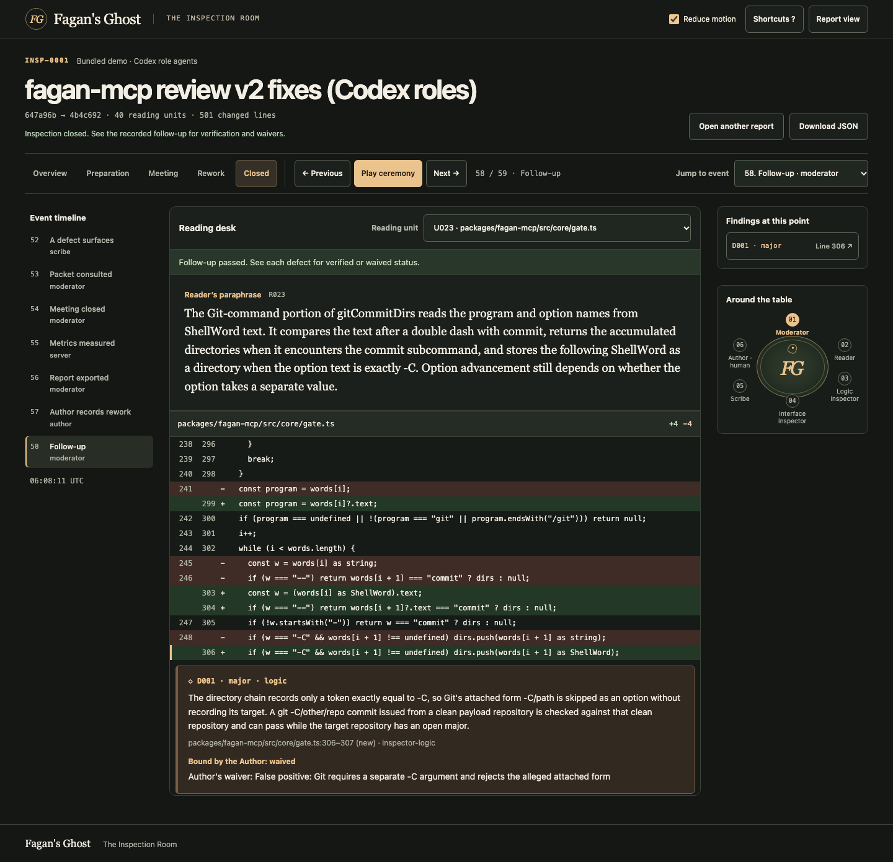

# Fagan's Ghost

**Someone has to read the code.** Fagan's Ghost gives developers, students and small teams a repeatable inspection ritual for AI-written changes: a Reader explains each unit, inspectors challenge it, a Scribe records the findings, and the human Author decides what to fix or accept.

A local, deterministic MCP server enforces the phases and keeps the record. The Inspection Room turns that record into a quiet séance around a table, with findings pinned to their code and a printable green-bar report alongside it.

**Try it locally:** [Open the Inspection Room](#open-the-inspection-room). **Hosted viewer:** `https://YOUR_GITHUB_USERNAME.github.io/fagans-ghost/` (placeholder; not deployed).



The screenshot shows the closed record, including the Author’s false-positive waiver for D001.

## Open the Inspection Room

Requires **Node.js 22.12 or newer**, npm and Git. From this repository:

```sh
npm ci
npm run build
npm run dev --workspace inspection-room
```

Open the local URL Vite prints, then choose **Enter the demo inspection**. Or choose **Open a report** and select `.fagan/inspections/insp-0001/report.json`. Uploaded files stay in the browser. No backend, account or model API is involved.

Jump to a phase, choose a timeline event, or step with the arrow keys. Select a reading unit to see its code, or choose a finding to jump to its recorded line. Switch to **Report view** for the plain listing. Reduced motion follows the operating system and can also be enabled in the viewer. The shortcuts dialog lists keyboard controls.

The bundled record is an actual inspection of this repository: 501 changed lines, 40 Reader paraphrases and one major finding, D001, concerning Git's attached `-C/path` option. The [verification note](docs/inspections/insp-0001-D001-verification.md) shows that Git rejects this syntax, so the human Author explicitly waived D001 as a false positive. It was conducted by **Codex role agents**, using the real MCP server after Kiro reached its usage limit. Its current phase is **Closed**: follow-up reran the build and tests successfully, with D001 retained as **waived**, not fixed or exorcised. See [the exported record](.fagan/inspections/insp-0001/report.json) and [Kiro usage](KIRO_USAGE.md) for provenance.

## Run an inspection in Kiro

Open this repository in Kiro after building it. The committed [MCP configuration](.kiro/settings/mcp.json) registers `fagan` using:

```json
{
  "mcpServers": {
    "fagan": {
      "command": "node",
      "args": ["packages/fagan-mcp/dist/cli.js", "serve"],
      "env": {},
      "disabled": false
    }
  }
}
```

This source-checkout configuration expects the repository as the working directory. Use the power setup below for another repository.

Select the **moderator** custom agent. Ask it to inspect a small, real change, naming its base and head revisions and explaining your intent. For example: “Inspect HEAD against WORKTREE. The change adds validation to the report loader. Keep me as the Author.” The server checks the actual build, tests and diff size before creating a record. The default limit is 1,500 changed lines; narrow a larger change into meaningful ranges instead of skipping checks.

Keep Author approval for `record_rework` on a per-call basis. Do not choose “Always allow”; the role agents are not the Author.

The ceremony is explicit:

1. **Planning and overview:** the Moderator opens the inspection and gets its packet.
2. **Preparation:** both inspectors read the units and their file-specific checklists.
3. **Meeting:** the Reader paraphrases each unit without judging; inspectors raise findings; only the Scribe logs defects. The Moderator cannot close the meeting until every unit has a reading.
4. **Rework:** you review findings, change the code and record each resolution as the Author. A waiver requires a written reason.
5. **Follow-up:** the server reruns the configured checks and verifies the recorded fixes. Every major must be verified or explicitly waived before the inspection closes.

The [manual ritual](.kiro/steering/inspection-ritual.md) contains the role handoffs. Three [hooks](.kiro/hooks/) suggest inspections after large changes, block Kiro shell commits with unresolved majors, and run follow-up after recorded rework. The suggestion asks for acknowledgment; it does not silently start a meeting.

To read the saved inspection in a terminal:

```sh
less .fagan/inspections/insp-0001/report.txt
```

For a new real inspection, `node scripts/mcp-call.mjs open_inspection '<JSON arguments>'` calls the same stdio server. Supply `role`, `title`, `base` and `head`. This starts an inspection. The participants then provide readings and findings. Metrics and export calls append to the inspection log, so use the saved reports when replaying the bundled demo. See [tool schemas and roles](packages/fagan-mcp/src/server/server.ts).

## Bring the ritual to another repository

Build the power from this checkout:

```sh
npm run build
node scripts/build-power.mjs
```

In the **Kiro IDE**, use **Powers → Add Custom Power → Import power from folder**, then select `power/`. Invoke `fagan-setup` in the target repository. This native Kiro import and activation still need a live IDE verification; the setup script and local MCP installation have a separate passing scratch-repository test. Generated bundle files are not committed, so import the locally built folder rather than an unbuilt GitHub checkout.

You can also preview setup directly. Substitute absolute paths and the target repository's actual build and test commands:

```sh
node /absolute/fagans-ghost/power/skills/fagan-setup/scripts/setup.mjs \
  --target /absolute/target-repo \
  --build '["npm","run","build"]' \
  --test '["npm","test"]'
```

Inspect the plan, then repeat with `--apply` to install. Setup refuses conflicting files and symlink destinations, preserves other MCP servers, and backs up an existing MCP configuration before adding `fagan`. It copies the bundled server to `.fagan/bin/fagan.mjs` and the agents, hooks and steering to `.kiro/`. Reload Kiro afterward. The MCP backup is created with owner-only permissions and excluded by a target-local `.fagan/.gitignore`. It may contain credentials from the previous configuration; review it before staging `.fagan/` files.

The power contains setup and inspection skills. Setup registers a **workspace** MCP server because a power's default server working directory is its installation directory, not the repository being inspected. See [power verification](docs/power-verification.md) for tested boundaries.

## What keeps the record honest

`packages/fagan-mcp` is a strict TypeScript stdio MCP server with nine tools: `open_inspection`, `get_packet`, `record_reading`, `log_defect`, `close_meeting`, `record_rework`, `follow_up`, `metrics` and `export_report`. Its plain files live in `.fagan/inspections/<id>/`; the self-contained `fagan-report/1` export includes packet, readings, defects, events, check results and metrics.

Preparation and inspection rates use server-recorded phase timestamps. They include orchestration delays and are **not** measurements of attention, human reading speed or defect-detection effectiveness. Undefined rates remain null with an explanation. There is no eyes-on-time tracking and no shared code with Read Receipt.

A fixed finding is verified using passing configured checks and a change to its recorded file. This establishes that evidence, not proof that the defect is semantically eliminated. The human must assess the repair. Declared MCP roles are workflow assertions, not authenticated identities. Kiro's scoped permissions restrict the supplied agents, but a local user controls the repository and can call tools directly.

The commit hook covers supported literal Git command forms inside Kiro. It is not a shell security boundary and does not intercept commands in an ordinary terminal. Keep source reports private when they contain private code; hosting a report publishes its contents. Neither the server nor viewer calls an LLM; Kiro's own model access remains subject to the user's account limits.

## Develop and verify

```sh
npm test
npm run build
npm run test:e2e
npm run build:power
npm run test:power
npm run check:repo
```

The suite includes Vitest unit tests, fast-check properties linked to EARS requirements, an MCP contract test over stdio, and Playwright viewer tests. Browser tests may require `npx playwright install chromium`. The repository check guards `.kiro/` and the MIT license. These commands are local checks; they do not imply hosted CI or deployment has run.

Read [PLAN.md](PLAN.md) for the approved design, [.kiro/specs](.kiro/specs/) for requirements and tasks, and [experiments](docs/experiments.md) for observed failures and fixes. [KIRO_USAGE.md](KIRO_USAGE.md) separates real Kiro experiments from Codex implementation and outstanding IDE checks. Publication commands and remaining submission fields are in [SUBMISSION_CHECKLIST.md](SUBMISSION_CHECKLIST.md).

## Why resurrect inspection?

Michael E. Fagan published *Design and code inspections to reduce errors in program development* in the **IBM Systems Journal** in 1976, 15(3), 182–211 ([DOI](https://doi.org/10.1147/sj.153.0182); [IBM reprint](https://userweb.cs.txstate.edu/~rp31/papersSQ/Fagan76.pdf)). This project adapts formal inspection into an agent ceremony. Its precise roles, phase names and thresholds are project choices, not claims that every detail appeared in that paper. No historical productivity or defect-removal percentage is claimed.

For **Kiroween 2026, Resurrection**, the creative idea is to give a demanding older practice a new interface and participants while keeping its human decision point. [The project story](DEVPOST_STORY.md) and [video shotlist](VIDEO_SHOTLIST.md) explain the intended demonstration.

## License and disclosures

Fagan's Ghost is [MIT licensed](LICENSE). No pre-existing application template or code from another hackathon entry was incorporated. The repository began with its project plan; the implementation was developed with Kiro and later continued with Codex after an explicit runtime switch. The real demonstration record identifies that switch.

Standard open-source development resources include the MCP TypeScript SDK, Zod, picomatch, TypeScript, Vite, Vitest, fast-check, esbuild, Playwright and axe-core. Pinned dependency versions are in `package-lock.json`, and bundled notices are in [power/THIRD_PARTY_NOTICES.txt](power/THIRD_PARTY_NOTICES.txt). The interface uses original CSS, system fonts and a locally bundled illustration created with OpenAI image generation. Synthetic fixtures exist only in tests and isolated protocol experiments. The viewer's demo is copied from the real inspection export.
